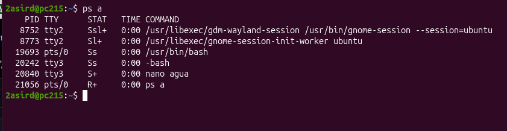
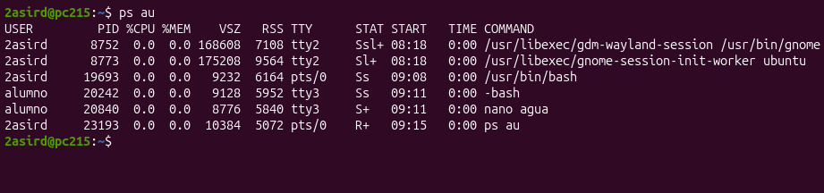
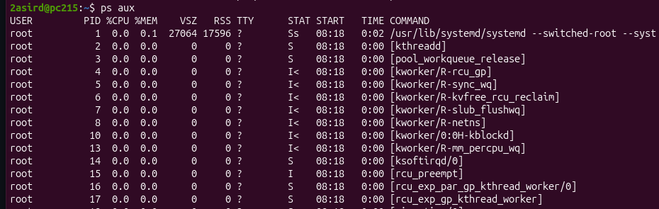
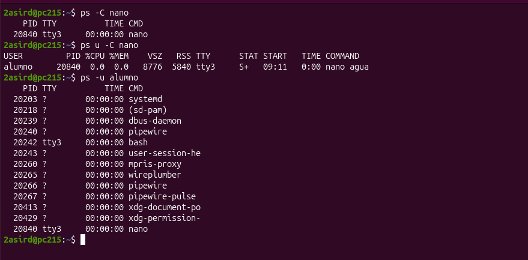
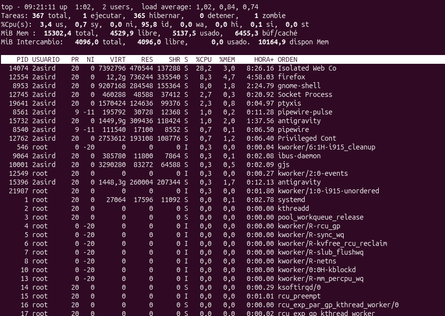
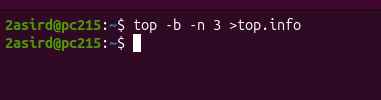
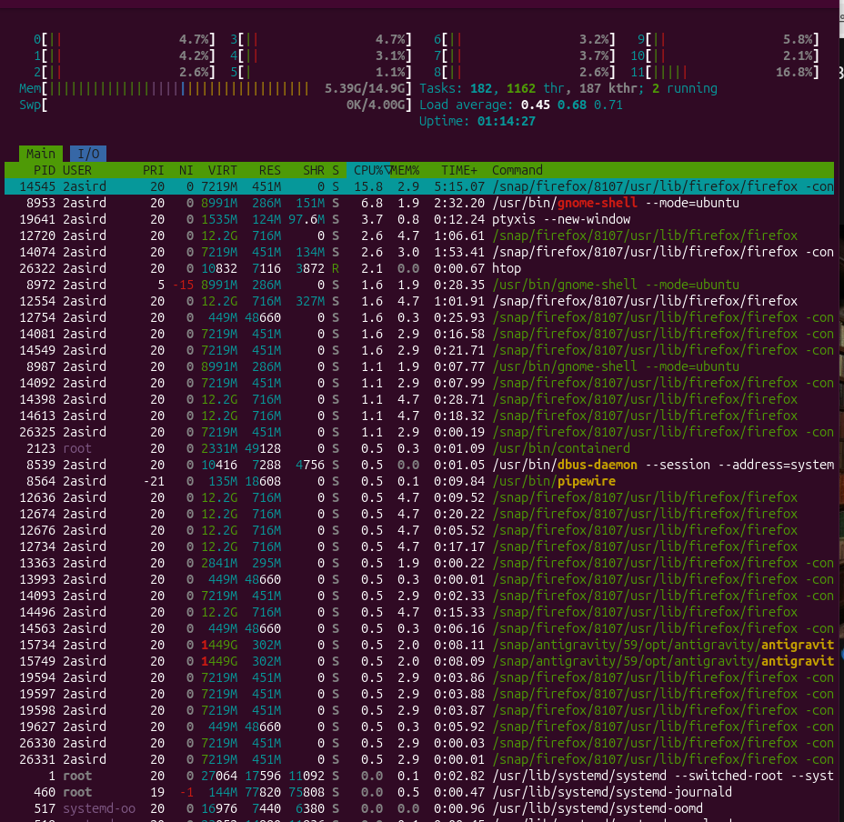
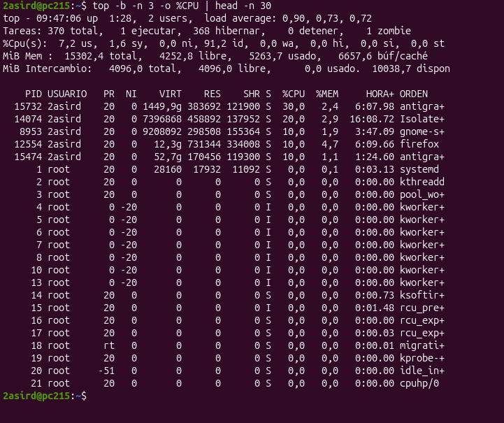
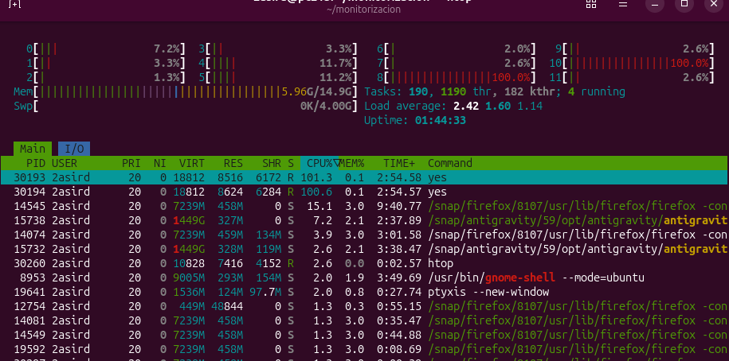

# 1. Procesos y Rendimiento de CPU

Guía práctica y resumen técnico de las capturas de gestión de procesos en Linux (`ps`, `top` y `htop`).

---

## 📑 Índice de Capturas

1. [Captura 1: Filtrado de procesos con terminal (`ps a`)](#captura-1-ps-a)
2. [Captura 2: Formato de usuario con recursos (`ps au`)](#captura-2-ps-au)
3. [Captura 3: Inspección global de procesos y kernel (`ps aux`)](#captura-3-ps-aux)
4. [Captura 4: Filtrado por comando y usuario (`ps -C`, `ps -u`)](#captura-4-filtrado-por-comando-y-usuario)
5. [Captura 5: Monitor dinámico en tiempo real (`top`)](#captura-5-top)
6. [Captura 6: Modo batch y volcado a fichero (`top -b`)](#captura-6-top--b)
7. [Captura 7: Monitor interactivo multihilo (`htop`)](#captura-7-htop)
8. [Captura 8: Top 10 procesos por CPU en 3 periodos](#captura-8-top-10-procesos-en-3-periodos)
9. [Captura 9: Eliminar un proceso en bucle infinito (`Kill`)](#captura-9-eliminar-proceso-en-bucle)

---

## Captura 1: `ps a`

<div align="center">
  
</div>

- **Comando:** `ps a` (muestra procesos con TTY de todos los usuarios).
- **Columnas:** `PID` (ID único), `TTY` (terminal asociada), `STAT` (estado), `TIME` (tiempo de CPU acumulado), `COMMAND` (comando).
- **Procesos clave:**
  - `gdm-wayland-session` / `gnome-session`: Sesión gráfica de escritorio en `tty2`.
  - `/usr/bin/bash`: Shell de la terminal gráfica en `pts/0`.
  - `-bash`: Shell de inicio de sesión de `alumno` en consola virtual `tty3`.
  - `nano agua`: Editor de texto interactivo en `tty3`.
  - `ps a`: El propio comando en ejecución activa (`R+`).

---

## Captura 2: `ps au`

<div align="center">
  
</div>

- **Comando:** `ps au` (añade formato orientado a usuario con consumo de memoria y CPU).
- **Nuevas columnas:**
  - `USER`: Propietario del proceso (`2asird` o `alumno`).
  - `%CPU` / `%MEM`: Porcentaje de uso de procesador y memoria RAM.
  - `VSZ`: Memoria virtual total reservada (KiB).
  - `RSS`: Memoria física real en RAM (KiB).
  - `START`: Hora de inicio del proceso.

---

## Captura 3: `ps aux`

<div align="center">
  
</div>

- **Comando:** `ps aux` (radiografía total del sistema, incluye procesos sin terminal `TTY ?`).
- **Procesos clave del sistema:**
  - `systemd` (PID 1): Proceso inicial (*init*) y padre de todos los procesos.
  - `[kthreadd]` (PID 2): Gestor de todos los hilos del espacio del kernel `[...]`.
  - `[kworker/...]`: Hilos de trabajo del kernel para E/S, red y temporizadores.
  - `[ksoftirqd/0]`: Gestor de interrupciones de software del núcleo 0.
  - `[rcu_*]`: Sincronización de memoria del kernel sin bloqueos (*Read-Copy-Update*).

---

## Captura 4: Filtrado por comando y usuario

<div align="center">
  
</div>

- **Comandos:**
  - `ps -C nano`: Busca directamente los procesos con nombre `nano` (PID 20840 en `tty3`).
  - `ps u -C nano`: Muestra el proceso `nano` con formato detallado de usuario (usuario `alumno`).
  - `ps -u alumno`: Lista todos los procesos pertenecientes al usuario `alumno` (`systemd --user`, `dbus-daemon`, `pipewire`, `wireplumber`, `bash`, `nano`).

---

## Captura 5: `top`

<div align="center">
  
</div>

- **Comando:** `top` (monitor interactivo dinámico en tiempo real).
- **Cabecera:**
  - `load average: 1.02, 0.84, 0.74`: Carga media a 1, 5 y 15 minutos.
  - `367 total`: 1 ejecutando, 365 hibernando, 1 zombie.
  - `%Cpu(s)`: 95.8% ocioso (`id`), 0.0% espera de disco (`wa`).
  - `MiB Mem`: 15 GB total, 4.5 GB libre, 5.1 GB usado, 6.4 GB en caché. Swap en 0 KB usado.
- **Opciones rápidas:**
  - `-b`: Modo batch (texto plano para scripts).
  - `-n <N>`: Límite de iteraciones antes de salir.
  - `-p <PID>`: Monitorizar solo los PIDs indicados.
  - `-u <user>`: Filtrar por usuario.
  - Teclas: <kbd>M</kbd> (ordenar por RAM), <kbd>P</kbd> (ordenar por CPU), <kbd>k</kbd> (matar proceso), <kbd>r</kbd> (cambiar prioridad *nice*).

---

## Captura 6: `top -b`

<div align="center">
  
</div>

- **Comando:** `top -b -n 3 >top.info`
- **Uso:** Toma 3 muestras consecutivas (`-n 3`) en texto plano (`-b`) y las guarda en el archivo `top.info`. Indispensable para auditorías desatendidas y tareas en `cron`.

---

## Captura 7: `htop`

<div align="center">
  
</div>

- **Comando:** `htop` (visor avanzado interactivo con soporte de ratón y barras de color).
- **Panel superior:**
  - Barras 0 a 11: Carga individual de cada uno de los 12 núcleos de la CPU.
  - Barras `Mem` (5.39 GB / 14.9 GB) y `Swp` (0 KB / 4.0 GB).
- **Procesos destacados:** Pestañas de Firefox (`Isolated Web Content`, 15.8% CPU), `gnome-shell` (interfaz visual), `ptyxis` (terminal) y demonio de contenedores `containerd`.

---

## Captura 8: Top 10 procesos en 3 periodos

<div align="center">
  
</div>

- **Requerimiento:** Extraer los 10 procesos que más CPU consumen durante 3 periodos consecutivos.
- **Comando utilizado:**
  ```bash
  top -b -n 3 -o %CPU | awk '/^top - /{c=0; print "\n=== PERIODO ==="} c<17 {print; c++}'
  ```
- **Fichero para el jefe de proyecto:** Añadir `> informe_top10_cpu.txt` al final de la orden.

---

## Captura 9: Eliminar proceso en bucle

<div align="center">
  
</div>

- **Problema:** Un script o tarea en bucle infinito satura un núcleo de la CPU al 100%.
- **Procedimiento en `htop`:**
  1. Localizar la tarea que consume el 100% de CPU.
  2. Seleccionar el proceso con las flechas.
  3. Pulsar <kbd>F9</kbd> (*Kill*).
  4. Seleccionar la señal **`9) SIGKILL`** para forzar el cierre inmediato del proceso bloqueado.
  5. El proceso termina y la CPU vuelve a sus niveles normales.

---

[⬅️ Volver al Índice Principal](README.md)
