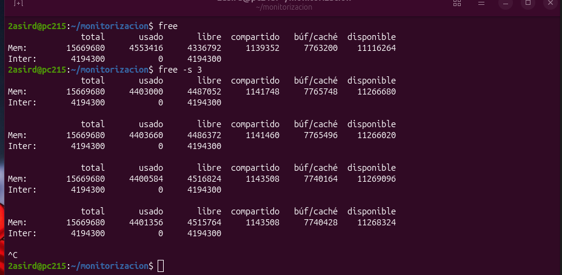

# 2. Monitorización y Análisis de Memoria, Espacio y Rendimiento de Disco

En este documento se analiza en profundidad la gestión de memoria RAM física, memoria de intercambio (*Swap*), espacio en almacenamiento y rendimiento de entrada/salida (E/S) en un sistema GNU/Linux Ubuntu, desglosando las capturas prácticas realizadas y la interpretación técnica de sus métricas.

---

## 📑 Índice de Prácticas y Capturas

- [1. Arquitectura de Memoria en Linux](#1-arquitectura-de-memoria-en-linux)
- [2. Captura 1: Inspección Periódica con `free` y `free -s 3`](#captura-1-inspección-periódica-con-free-y-free--s-3)
  - [Comandos ejecutados](#-comandos-ejecutados)
  - [Significado técnico de las columnas](#-significado-técnico-de-las-columnas)
  - [Parámetros y modificadores clave de `free`](#-parámetros-y-modificadores-clave-de-free)
  - [Análisis e interpretación del estado de la Swap](#-análisis-e-interpretación-del-estado-de-la-swap)

---

## 1. Arquitectura de Memoria en Linux

A diferencia de otros sistemas operativos, el kernel Linux sigue la filosofía de que **la memoria RAM no utilizada es memoria desperdiciada**. Por este motivo, el sistema aprovecha toda la memoria física desocupada para acelerar los accesos a disco mediante la **Caché de Páginas (Page Cache)** y los **Búferes de E/S**.

<div align="center">
  
</div>

- **Memoria Real Disponible**: En caso de que una aplicación requiera más memoria de forma repentina, el kernel libera instantáneamente la memoria dedicada a caché para cedérsela al programa sin pérdida de rendimiento.
- **Memoria de Intercambio (Swap)**: Espacio secundario reservado en disco (en partición o archivo de intercambio) para almacenar páginas de memoria inactivas cuando la RAM física se satura.

---

## Captura 1: Inspección Periódica con `free` y `free -s 3`

<div align="center">
  
</div>

### 🔹 Comandos ejecutados

1. **`free`**:
   - Muestra el estado instantáneo de la memoria física y de intercambio en bloques de **Kibibytes (KiB)** por defecto.
2. **`free -s 3`**:
   - Activa el refresco periódico automático en intervalos continuos de **3 segundos** (`-s 3`). Permite monitorizar en vivo cómo fluctúan los valores de memoria en la terminal sin necesidad de relanzar el comando manualmente.

---

### 🔹 Significado técnico de las columnas

| Columna | Significado Técnico | Interpretación en Administración (ASIR / DevOps) |
| :--- | :--- | :--- |
| **`total`** | Memoria física total utilizable por el sistema. | Corresponde a la RAM total instalada menos las pequeñas regiones reservadas fijas del kernel y la BIOS/UEFI (~15.6 GB en la captura). |
| **`used`** | Memoria en uso activo por procesos y el sistema. | Calculada como: $\text{used} = \text{total} - \text{free} - \text{buffers} - \text{cache}$. Representa la memoria que realmente no puede liberarse sin cerrar aplicaciones. |
| **`free`** | Memoria estrictamente sin asignar (en reposo). | En Linux es normal que este valor sea bajo tras unas horas de uso, ya que el kernel la destina a acelerar lecturas de disco. |
| **`shared`** | Memoria compartida utilizada. | Utilizada por sistemas de archivos temporales en memoria (`tmpfs`) y mecanismos IPC (*Inter-Process Communication*). |
| **`buff/cache`** | Memoria asignada a Búferes y Caché de disco. | **Búferes**: Estructuras del sistema de ficheros (inodos, directorios).<br>**Caché**: Datos de archivos leídos recientemente. **Es 100% recuperable de inmediato**. |
| **`available`** | **Memoria disponible real para nuevas aplicaciones.** | **Es la métrica más crítica de salud del servidor.** Estima cuánta RAM puede entregarse a un nuevo proceso sin forzar al sistema a hacer swapping a disco. |

---

### 🔹 Parámetros y modificadores clave de `free`

| Parámetro | Función | Utilidad Práctica |
| :---: | :--- | :--- |
| **`-s <seg>`** | **Modo muestreo continuo (*seconds*):** Actualiza el informe cada `N` segundos (p. ej. `free -s 3`). Se detiene con <kbd>Ctrl + C</kbd>. | Observar variaciones en directo durante pruebas de estrés o ejecución de cargas pesadas. |
| **`-c <veces>`** | **Contador de repeticiones (*count*):** Define el número exacto de actualizaciones antes de salir (p. ej. `free -s 2 -c 5` toma 5 muestras cada 2 seg). | Automatización de volcados y scripts de diagnóstico temporal. |
| **`-h`** | **Formato humano legible (*human-readable*):** Muestra automáticamente las unidades más adecuadas (B, KiB, MiB, GiB). | Lectura visual rápida para administradores (ej. `7.7Gi` en lugar de `8087296`). |
| **`-m` / `-g`** | **Unidades forzadas:** Muestra los valores forzados en Megabytes (`-m`) o Gigabytes (`-g`). | Estandarizar métricas para análisis cuantitativo. |
| **`-w`** | **Modo ancho (*wide mode*):** Desglosa las columnas `buffers` y `cache` en dos campos separados en lugar de sumarlos. | Diagnosticar con precisión si el consumo de caché proviene de ficheros o de metadatos de sistema. |
| **`-t`** | **Total acumulado:** Añade una fila inferior con la suma agregada de RAM + Swap. | Conocer la capacidad combinada de memoria de la máquina. |

---

### 🔹 Análisis e interpretación del estado de la Swap

En la captura se aprecia:
```text
Swap:        4194300           0     4194300
```

1. **Capacidad:** Existen 4.194.300 KiB (~4.0 GiB) configurados como área de intercambio.
2. **Uso (`used = 0`):** No se ha trasladado ninguna página de memoria a disco.
3. **Diagnóstico:**
   - Que el uso de Swap sea **0** confirma que la máquina cuenta con suficiente memoria física (RAM) para soportar todas las cargas de trabajo actuales.
   - Si la columna `used` en Swap comenzase a crecer progresivamente y se observara actividad continua de lectura/escritura (detectable con `vmstat` en las columnas `si` y `so`), el sistema entraría en **Swapping** (*Thrashing*), lo que provocaría lentitud extrema en todo el sistema al depender de la velocidad del almacenamiento en lugar de la velocidad de la RAM.

---

> [!TIP]
> Puedes volver al índice principal del repositorio en cualquier momento consultando el [README.md](README.md).
