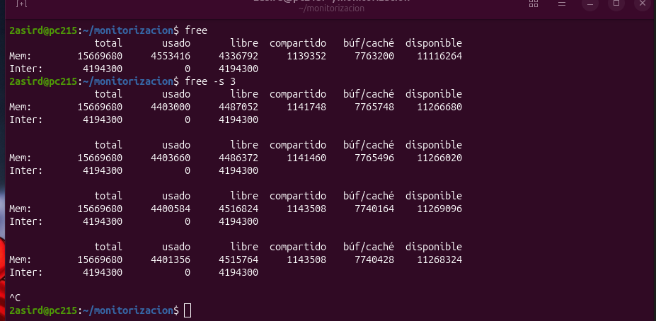
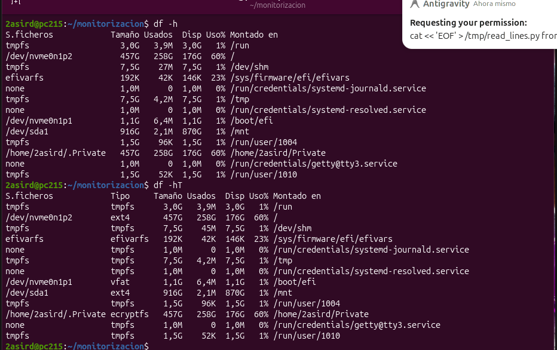
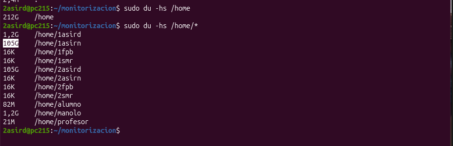
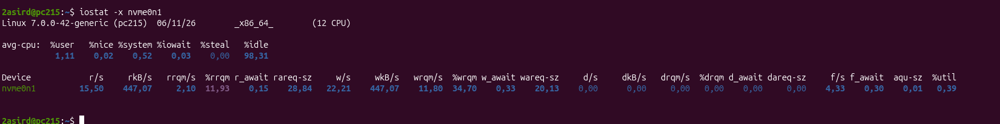
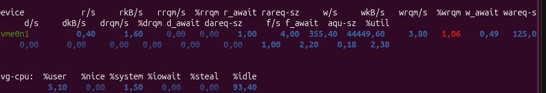

# 2. Memoria, Espacio y Rendimiento de Disco

Guía práctica y resumen técnico de las capturas de gestión de memoria RAM, Swap, rendimiento de E/S y espacio en disco en Linux (`free`, `vmstat`, `swapon`, `iostat` y `df`).

---

## 📑 Índice de Capturas

1. [Captura 1: Monitorización periódica con `free` y `free -s`](#captura-1-free-y-free--s)
2. [Captura 2: Modificadores y formatos de unidades en `free`](#captura-2-modificadores-de-free)
3. [Captura 3: Estadísticas de memoria, Swap y CPU con `vmstat`](#captura-3-vmstat)
4. [Captura 4: Inspección y control de particiones Swap (`swapon` / `swapoff`)](#captura-4-gestión-de-swap)
5. [Captura 5: Rendimiento de E/S en disco con `iostat`](#captura-5-rendimiento-de-es-con-iostat)
6. [Captura 6: Saturación de disco y cuello de botella (`%util` en rojo)](#captura-6-saturación-de-disco-util-en-rojo)
7. [Diagnóstico de Espacio en Disco (`df -h`)](#diagnóstico-de-espacio-en-disco-df--h)

---

## Captura 1: `free` y `free -s`

  

- **Comandos:**
  - `free`: Estado puntual de la memoria RAM y Swap en KiB.
  - `free -s 3`: Actualización continua cada 3 segundos.
- **Columnas clave:**
  - `total`: RAM física utilizable (15.6 GB).
  - `used`: Memoria en uso real por programas (5.1 GB).
  - `free`: Memoria totalmente desocupada (4.3 GB).
  - `buff/cache`: Caché de lectura/escritura en disco (6.5 GB). Se libera sola si se necesita.
  - `available`: Memoria real utilizable antes de recurrir a Swap (10.1 GB).
  - `Swap used = 0`: Sistema holgado, sin paginación en disco.

---

## Captura 2: Modificadores de `free`

  

- **Modificadores principales:**
  - `free -h`: Formato legible (*Human-readable*, MiB/GiB automáticos).
  - `free -m` / `free -g`: Valores fijos en Megabytes o Gigabytes.
  - `free -s <seg>`: Intervalo de actualización periódica.
  - `free -c <num>`: Límite de repeticiones antes de terminar.
  - `free -w`: Modo ancho (*wide*), separa `buffers` y `cache`.
  - `free -t`: Fila resumen con el total de RAM + Swap.

---

## Captura 3: `vmstat`

  

- **Comando:** `vmstat` (*Virtual Memory Statistics*).
- **Métricas principales:**
  - **`procs`**: `r` (procesos ejecutando o en cola de CPU), `b` (procesos bloqueados por E/S).
  - **`memory`**: `swpd` (Swap usada), `free`, `buff`, `cache`.
  - **`swap`**:
    - `si` (*swap-in*): Tráfico de datos desde Swap hacia RAM (KiB/s).
    - `so` (*swap-out*): Tráfico volcado de RAM a Swap (KiB/s). Valores altos indican falta crítica de RAM.
  - **`io`**: Bloques leídos (`bi`) y escritos (`bo`) en disco.
  - **`cpu`**: `us` (usuario), `sy` (sistema), `id` (ocioso), `wa` (espera de disco *I/O wait*).

---

## Captura 4: Gestión de Swap

  

- **Comandos de control:**
  - `swapon --show`: Lista particiones y ficheros de intercambio activos con tamaño, uso y prioridad.
  - `cat /proc/swaps`: Lectura directa de las áreas de intercambio del kernel.
  - `sudo swapoff -a`: Desactiva la Swap descargando su contenido de vuelta a la RAM física.
  - `sudo swapon -a`: Activa todas las particiones Swap configuradas en `/etc/fstab`.

---

## Captura 5: Rendimiento de E/S con `iostat`

  

- **Comando:** `iostat -xz nvme0n1 5` / `iostat -x sda`
- **Métricas clave:**
  - `r/s` y `w/s`: Lecturas y escrituras completadas por segundo.
  - `rkB/s` y `wkB/s`: Rendimiento de transferencia en KiB/s.
  - `r_await` y `w_await`: Tiempo medio de espera (ms) que tarda el disco en atender una petición.
  - `aqu-sz`: Longitud media de la cola de peticiones pendientes.
  - `%util`: Porcentaje de tiempo en que el dispositivo estuvo ocupado atendiendo operaciones de E/S.

---

## Captura 6: Saturación de disco (`%util` en rojo)

  

- **¿Qué significa el número rojo?**
  - El valor de **`%util` alcanza el 99% - 100%**.
  - **Diagnóstico:** Indica **saturación total del dispositivo de almacenamiento** y un **cuello de botella de E/S (*I/O Bottleneck*)**.
  - **Consecuencias:** El disco no da abasto para procesar las peticiones en cola (`aqu-sz` crece), disparando los tiempos de latencia (`await`) y provocando que los procesos entren en estado bloqueado (`D` o `b` en `vmstat`), congelando la respuesta del sistema.

---

## Diagnóstico de Espacio en Disco (`df -h`)

*(Sección puramente explicativa sin captura de pantalla)*

- **Comandos:**
  - `df -h`: Muestra el espacio total, usado, disponible y el porcentaje de ocupación (`Use%`) de todos los sistemas de archivos montados en formato legible (Gigas/Megas).
  - `df -hT`: Añade la columna `Type` para identificar el sistema de archivos (`ext4`, `xfs`, `vfat`, `btrfs`, `tmpfs`).
- **Utilidad:** Comprobación rápida para prevenir fallos críticos por llenado de particiones (`/`, `/home`, `/var`).

---

[⬅️ Volver al Índice Principal](README.md)
