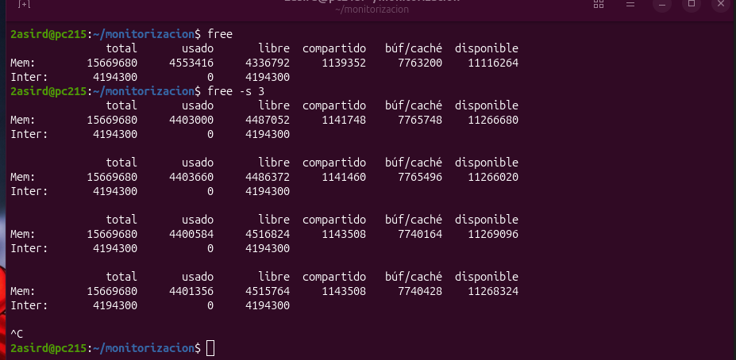
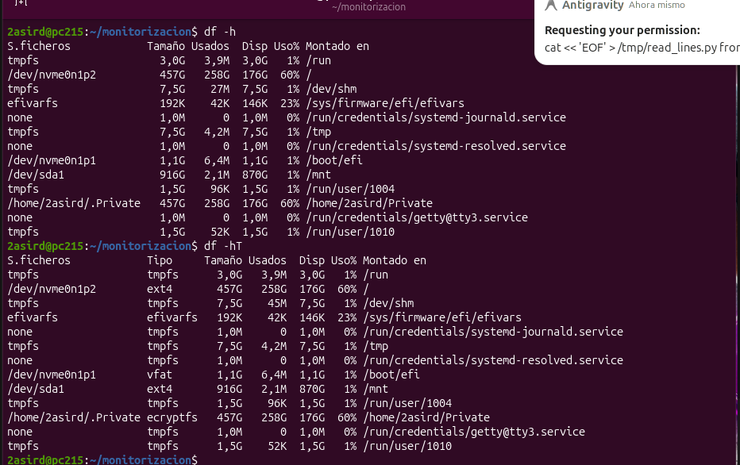
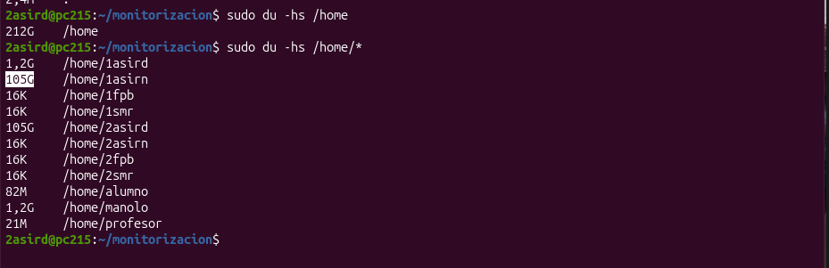

# 2. Memoria, Espacio y Rendimiento de Disco

Guía práctica y resumen técnico de las capturas de gestión de memoria RAM, Swap y rendimiento de E/S en Linux (`free`, `vmstat` y `swapon`).

---

## 📑 Índice de Capturas

1. [Captura 1: Monitorización periódica con `free` y `free -s`](#captura-1-free-y-free--s)
2. [Captura 2: Modificadores y formatos de unidades en `free`](#captura-2-modificadores-de-free)
3. [Captura 3: Estadísticas de memoria, Swap y CPU con `vmstat`](#captura-3-vmstat)
4. [Captura 4: Inspección y control de particiones Swap (`swapon` / `swapoff`)](#captura-4-gestión-de-swap)

---

## Captura 1: `free` y `free -s`

  

- **Comandos:**
  - `free`: Muestra el estado puntual de la memoria RAM y Swap en KiB.
  - `free -s 3`: Actualiza continuamente los datos en la terminal cada 3 segundos.
- **Columnas clave:**
  - `total`: RAM física utilizable (15.6 GB).
  - `used`: Memoria en uso real por el sistema y programas (5.1 GB).
  - `free`: Memoria totalmente desocupada (4.3 GB).
  - `buff/cache`: Memoria usada por el kernel como caché de disco para acelerar accesos (6.5 GB). **Se libera automáticamente si un programa la necesita.**
  - `available`: **Métrica clave.** Memoria real disponible para abrir nuevas aplicaciones sin tener que usar Swap (10.1 GB).
  - `Swap used = 0`: Sistema desahogado, no necesita volcar páginas de memoria al disco.

---

## Captura 2: Modificadores de `free`

  

- **Modificadores principales de `free`:**
  - `free -h`: Formato humano legible (*Human-readable*), ajusta automáticamente las unidades a MiB o GiB.
  - `free -m`: Fuerza la visualización de todos los valores en Megabytes (MiB).
  - `free -g`: Muestra los valores en Gigabytes (GiB).
  - `free -s <seg>`: Intervalo de refresco continuo en segundos.
  - `free -c <num>`: Límite de repeticiones antes de salir (ej. `free -s 2 -c 3`).
  - `free -w`: Modo ancho (*wide*), separa en dos columnas independientes `buffers` y `cache`.
  - `free -t`: Muestra una fila final con la suma total de RAM + Swap.

---

## Captura 3: `vmstat`

  

- **Comando:** `vmstat` (Virtual Memory Statistics).
- **Grupos de métricas:**
  - **`procs`**:
    - `r`: Procesos en ejecución o esperando CPU (cola de planificación).
    - `b`: Procesos en sueño ininterrumpible (*blocked* por operaciones de E/S).
  - **`memory`**: Memoria usada en `swpd`, memoria libre (`free`), búferes (`buff`) y caché (`cache`).
  - **`swap`**:
    - `si` (*swap-in*): Memoria leída desde el disco Swap hacia la RAM (KiB/s).
    - `so` (*swap-out*): Memoria escrita desde la RAM hacia la Swap (KiB/s). Valores $> 0$ continuos indican falta de RAM.
  - **`io`**: Bloques recibidos (`bi`) y enviados (`bo`) a dispositivos de disco.
  - **`cpu`**: Tiempo de CPU en usuario (`us`), kernel (`sy`), ocioso (`id`) y esperando disco (`wa` = *I/O wait*).

---

## Captura 4: Gestión de Swap

  

- **Comandos de inspección y control de Swap:**
  - `swapon --show` o `swapon -s`: Muestra las particiones y archivos de intercambio activos, su tamaño, espacio usado y prioridad.
  - `cat /proc/swaps`: Información directa del kernel sobre las áreas de Swap montadas.
  - `sudo swapoff -a`: Desactiva temporalmente todas las áreas de intercambio volcando su contenido de vuelta a la RAM.
  - `sudo swapon -a`: Reactiva todas las particiones de Swap definidas en `/etc/fstab`.

---

[⬅️ Volver al Índice Principal](README.md)
