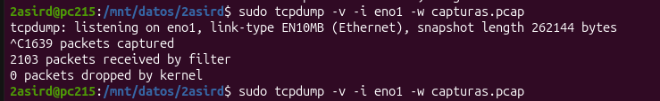
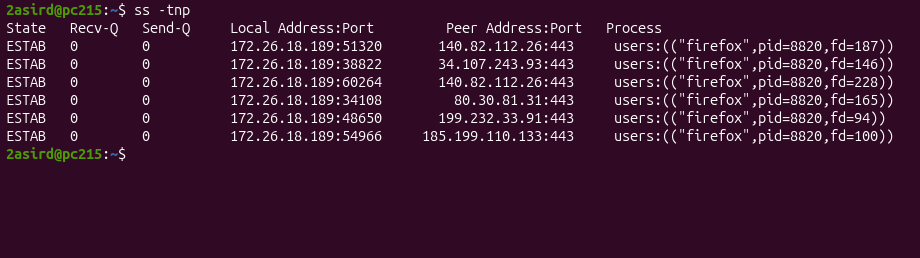
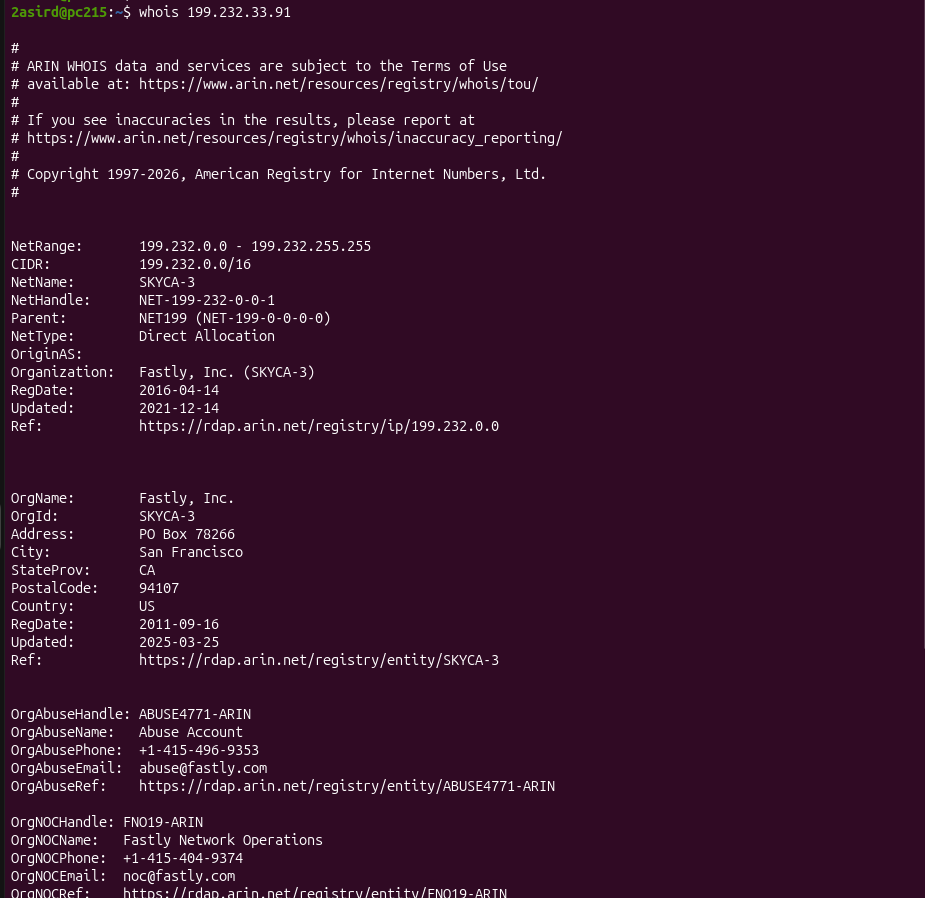
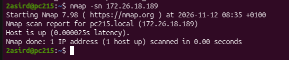
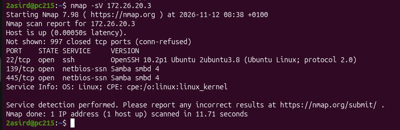
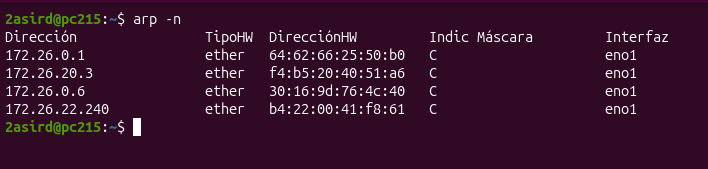
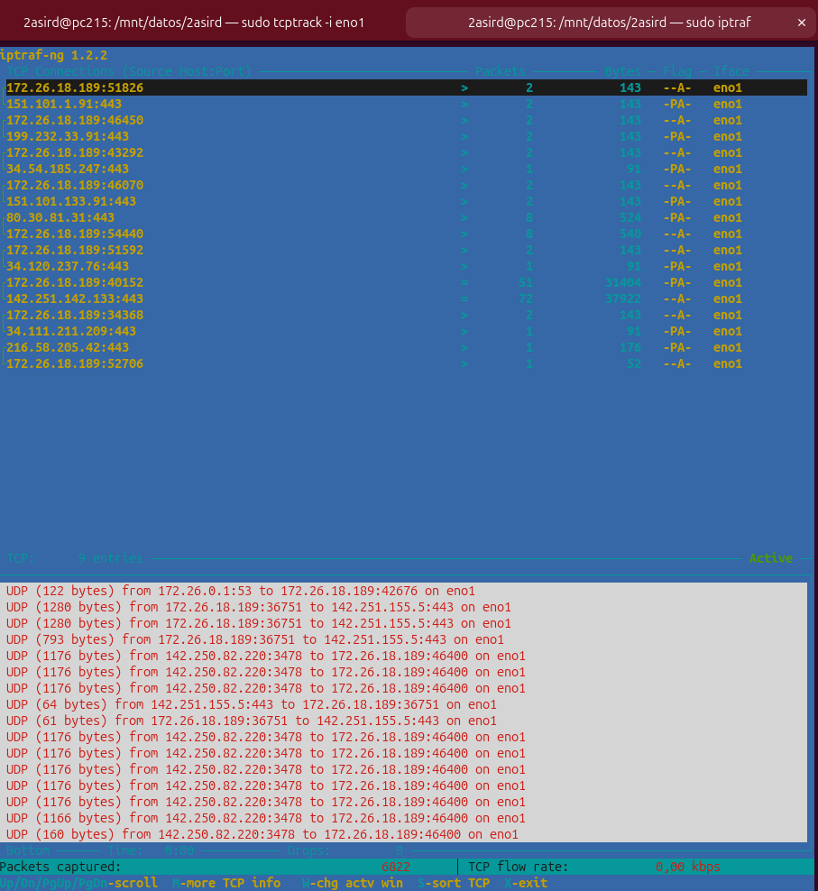

# 3. Tráfico y Monitorización de Red

Guía práctica y resumen técnico de las herramientas de monitorización, análisis de tráfico, auditoría y diagnóstico de redes en Linux (`ip`, `ss`, `whois`, `nmap`, `arp`, `iptraf`, `tcptrack`, `bmon`, `tcpdump`, `ping` y `traceroute`).

---

## 📑 Índice de Herramientas

1. [Captura 1: Interfaces y estadísticas de red (`ip link`, `ip -s`)](#captura-1-interfaces-y-estadísticas-ip-link)
2. [Captura 2: Puertos en escucha y servicios (`ss -plunt`)](#captura-2-puertos-en-escucha-y-servicios-ss--plunt)
3. [Captura 3: Conexiones TCP activas y procesos en uso (`ss -tnp`)](#captura-3-conexiones-tcp-activas-y-procesos-ss--tnp)
4. [Captura 4: Consulta de titularidad IP con `whois`](#captura-4-consulta-de-titularidad-ip-whois)
5. [Captura 5: Auditoría y escaneo de redes con `nmap`](#captura-5-auditoría-y-escaneo-de-redes-nmap)
6. [Captura 6: Resolución de direcciones físicas con `arp`](#captura-6-resolución-de-direcciones-físicas-arp)
7. [Captura 7: Monitor de tráfico por protocolo con `iptraf`](#captura-7-monitor-de-tráfico-con-iptraf)
8. [Captura 8: Seguimiento de conexiones TCP con `tcptrack`](#captura-8-seguimiento-de-conexiones-tcp-tcptrack)
9. [Captura 9: Monitor de ancho de banda con `bmon`](#captura-9-monitor-de-ancho-de-banda-bmon)
10. [Diagnóstico de Red: `tcpdump`, `ping` y `traceroute`](#diagnóstico-de-red-tcpdump-ping-y-traceroute)

---

## Captura 1: Interfaces y estadísticas (`ip link`)

  

- **Comandos:**
  - `ip link`: Lista las interfaces físicas y virtuales (`lo`, `eno1`, `docker0`) y su estado operacional (`UP` / `DOWN`).
  - `ip -s link`: Muestra estadísticas acumuladas de tráfico por interfaz:
    - **`RX` (Recepción):** Bytes, paquetes, errores, descartes (*dropped*) y desbordamientos (*overrun*).
    - **`TX` (Transmisión):** Bytes, paquetes, errores, descartes y colisiones (*collsns*).

---

## Captura 2: Puertos en escucha y servicios (`ss -plunt`)

  

- **Comandos:**
  - `ss`: Vuelca todos los sockets y conexiones de red abiertas en el sistema (reemplazo moderno de `netstat`).
  - `ss -plunt`: Muestra únicamente los puertos en escucha y los procesos asociados de forma muy resumida:
    - `-p`: Identificador y nombre del proceso (*PID/Program*).
    - `-l`: Solo sockets en escucha (*LISTEN*).
    - `-u`: Protocolo UDP.
    - `-n`: Direcciones y puertos numéricos (sin resolver DNS).
    - `-t`: Protocolo TCP.

---

## Captura 3: Conexiones TCP activas y procesos (`ss -tnp`)

  

- **Comando:** `ss -tnp`
- **Utilidad:** Muestra las conexiones TCP establecidas actualmente en el equipo, indicando los puertos que están siendo utilizados y el proceso exacto que los mantiene abiertos:
  - `State ESTAB`: Conexión TCP completamente establecida y en transferencia.
  - `Local Address:Port`: Dirección IP local y puerto efímero de origen (ej. `172.26.18.189:48650`).
  - `Peer Address:Port`: Dirección IP de destino y puerto del servicio remoto (ej. `199.232.33.91:443` HTTPS).
  - `Process`: Aplicación y PID responsable de la conexión (ej. `users:(("firefox",pid=8820,fd=94))`).

---

## Captura 4: Consulta de titularidad IP (`whois`)

  

- **Comando:** `whois <IP>` (ej. `whois 199.232.33.91`)
- **Utilidad:** Consulta los registros públicos de los RIR (*Regional Internet Registries* como ARIN o RIPE) para investigar quién está detrás de una IP remota detectada en `ss`:
  - **Organización:** Titular de la infraestructura (ej. `Fastly, Inc. (SKYCA-3)`).
  - **Rango de red (`NetRange` / `CIDR`):** Bloque asignado (`199.232.0.0/16`).
  - **Ubicación y contacto:** Ciudad, país (`US - San Francisco`) y correos de contacto para abusos y operaciones de red (`abuse@fastly.com`, `noc@fastly.com`).

---

## Captura 5: Auditoría y escaneo de redes (`nmap`)

> **`nmap`**: Herramienta de referencia para escanear y auditar redes, descubrir equipos encendidos y analizar puertos o servicios expuestos.

### 5.1 Detección de host activo / Ping Scan (`nmap -sn`)

  

- **Comando:** `nmap -sn 172.26.18.189`
- **Utilidad:** Comprueba únicamente si el host objetivo está encendido y disponible (*Host is up*) sin realizar escaneo de puertos. Es rápido, no intrusivo y permite verificar conectividad en la subred.

### 5.2 Detección de puertos y versiones de servicios (`nmap -sV`)

  

- **Comando:** `nmap -sV 172.26.20.3`
- **Utilidad:** Escanea los puertos TCP abiertos e interroga a los demonios para determinar la versión exacta de cada servicio en ejecución:
  - `22/tcp open ssh`: Servidor SSH `OpenSSH 10.2p1 (Ubuntu Linux)`.
  - `139/tcp open netbios-ssn`: Servicio de compartición de archivos `Samba smbd 4`.
  - `445/tcp open netbios-ssn`: Protocolo SMB directo `Samba smbd 4`.
  - `Service Info: OS: Linux`: Identificación del sistema operativo remoto.

---

## Captura 6: Resolución de direcciones físicas (`arp`)

> **`arp`**: Protocolo y comando para conocer las direcciones físicas MAC de los equipos de la red local a los que te has conectado previamente.

  

- **Comando:** `arp -n`
- **Utilidad:** Muestra la tabla de correspondencias entre direcciones IP lógicas y direcciones físicas MAC en formato numérico (sin resolución de nombres):
  - **`Dirección`:** IP del equipo local (ej. `172.26.0.1`, `172.26.20.3`, `172.26.22.240`).
  - **`TipoHW`:** Tipo de hardware de red (`ether` / Ethernet).
  - **`DirecciónHW`:** Dirección física MAC única de la tarjeta de red (ej. `64:62:66:25:50:b0`, `f4:b5:20:40:51:a6`).
  - **`Indic`:** Bandera de estado (`C` = *Complete*, entrada válida en caché ARP).
  - **`Interfaz`:** Tarjeta de red local por la que se comunica (`eno1`).

---

## Captura 7: Monitor de tráfico con `iptraf`

  

- **Comando:** `sudo iptraf` (o `sudo iptraf-ng`)
- **Características:**
  - Menú interactivo ncurses para monitorización de tráfico en tiempo real.
  - Clasificación del flujo por protocolos (TCP, UDP, ICMP, IP no TCP).
  - Estadísticas por interfaz, paquetes por segundo y desglose de puertos de origen y destino.

---

## Captura 8: Seguimiento de conexiones TCP (`tcptrack`)

  

- **Comando:** `sudo tcptrack -i eno1`
- **Características:**
  - Rastrea en tiempo real únicamente conexiones TCP activas en la interfaz especificada.
  - Columnas: IP:puerto cliente, IP:puerto servidor, estado de la conexión (`ESTABLISHED`, `SYN_SENT`, `CLOSE_WAIT`) e **idle/speed** (velocidad de transferencia instantánea por flujo).

---

## Captura 9: Monitor de ancho de banda (`bmon`)

  

- **Comando:** `bmon` (*Bandwidth Monitor*)
- **Características:**
  - Interfaz visual compacta que muestra la tasa de transferencia en tiempo real (RX/TX en B/s o KiB/s).
  - Genera gráficas ASCII continuas de picos de ancho de banda y carga de red por cada interfaz.

---

## Diagnóstico de Red: `tcpdump`, `ping` y `traceroute`

*(Secciones puramente explicativas sin captura de pantalla, tal como se requirió)*

### 1. Captura de paquetes (`tcpdump`)
- **Comandos:**
  - `sudo tcpdump -v -i eno1`: Inspecciona en tiempo real el tráfico que atraviesa la interfaz con nivel de detalle (*verbose*).
  - `sudo tcpdump -v -i eno1 -w capturas.pcap`: Vuelca la captura a un archivo en formato estándar `.pcap` para su análisis posterior (compatible con Wireshark).
  - `tcpdump -r capturas.pcap`: Lee e interpreta un archivo de captura previo sin necesidad de privilegios especiales.

### 2. Conectividad básica (`ping`)
- **Comando:** `ping -c 4 <host/IP>` (ej. `ping google.es`)
- **Utilidad:** Envía paquetes ICMP *Echo Request* para verificar si el destino responde, medir la latencia ida y vuelta (*RTT en ms*) y detectar pérdida de paquetes (*packet loss*).

### 3. Trazado de ruta (`traceroute`)
- **Comando:** `traceroute <host/IP>`
- **Utilidad:** Muestra todos los saltos (*routers / hops*) intermedios que recorre un paquete hasta alcanzar su destino, midiendo el tiempo de respuesta de cada nodo para detectar cuellos de botella o caídas en la ruta.

---

[⬅️ Volver al Índice Principal](README.md)
