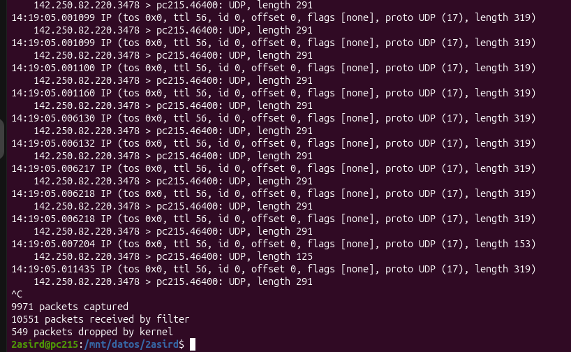
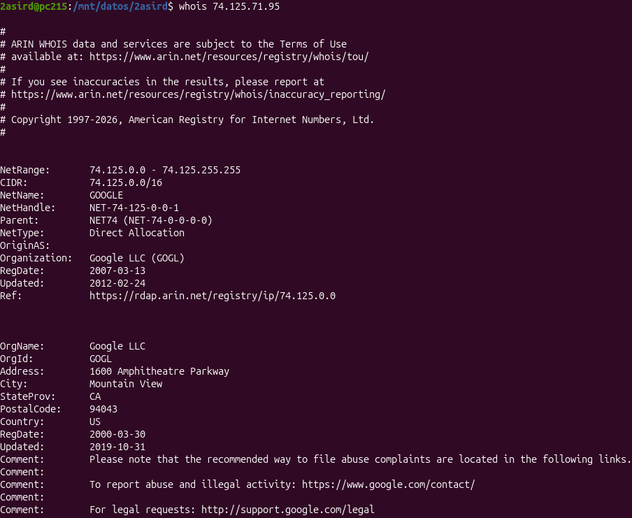
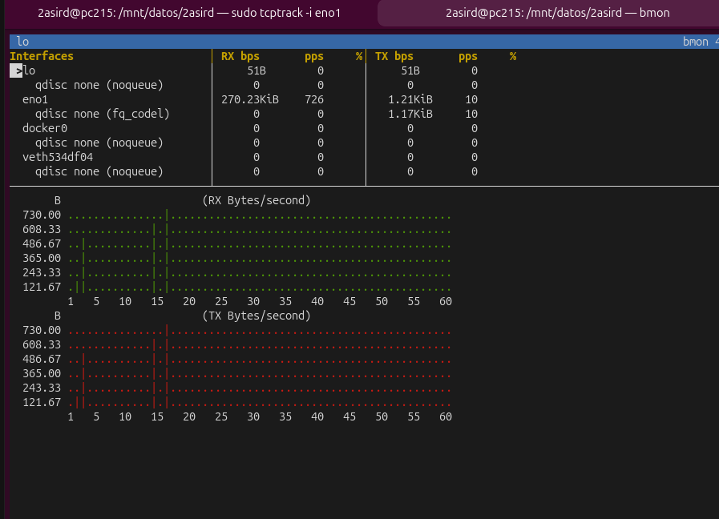
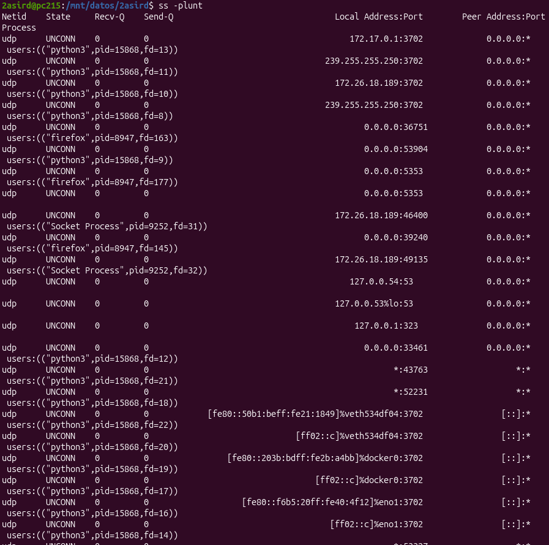

# 3. Tráfico y Monitorización de Red

Guía práctica y resumen técnico de las herramientas de monitorización, análisis de tráfico y diagnóstico de redes en Linux (`ip`, `ss`, `whois`, `iptraf`, `tcptrack`, `bmon`, `tcpdump`, `ping` y `traceroute`).

---

## 📑 Índice de Herramientas

1. [Captura 1: Interfaces y estadísticas de red (`ip link`, `ip -s`)](#captura-1-interfaces-y-estadísticas-ip-link)
2. [Captura 2: Sockets y conexiones activas (`ss`)](#captura-2-sockets-y-conexiones-activas-ss)
3. [Captura 3: Consulta de titularidad IP con `whois`](#captura-3-consulta-de-titularidad-ip-whois)
4. [Captura 4: Monitor de tráfico por protocolo con `iptraf`](#captura-4-monitor-de-tráfico-con-iptraf)
5. [Captura 5: Seguimiento de conexiones TCP con `tcptrack`](#captura-5-seguimiento-de-conexiones-tcp-tcptrack)
6. [Captura 6: Monitor de ancho de banda con `bmon`](#captura-6-monitor-de-ancho-de-banda-bmon)
7. [Diagnóstico de Red: `tcpdump`, `ping` y `traceroute`](#diagnóstico-de-red-tcpdump-ping-y-traceroute)

---

## Captura 1: Interfaces y estadísticas (`ip link`)

  

- **Comandos:**
  - `ip link`: Lista las interfaces físicas y virtuales (`lo`, `eno1`, `docker0`) y su estado operacional (`UP` / `DOWN`).
  - `ip -s link`: Muestra estadísticas acumuladas de tráfico por interfaz:
    - **`RX` (Recepción):** Bytes, paquetes, errores, descartes (*dropped*) y desbordamientos (*overrun*).
    - **`TX` (Transmisión):** Bytes, paquetes, errores, descartes y colisiones (*collsns*).

---

## Captura 2: Sockets y conexiones activas (`ss`)

  

- **Comandos:**
  - `ss`: Vuelca todos los sockets y conexiones de red abiertas en el sistema (reemplazo moderno de `netstat`).
  - `ss -plunt`: Muestra únicamente los puertos en escucha y los procesos asociados de forma muy resumida:
    - `-p`: Identificador y nombre del proceso (*PID/Program*).
    - `-l`: Solo sockets en escucha (*LISTEN*).
    - `-u`: Protocolo UDP.
    - `-n`: Direcciones y puertos numéricos (sin resolver DNS).
    - `-t`: Protocolo TCP.

---

## Captura 3: Consulta de titularidad IP (`whois`)

  

- **Comando:** `whois <IP>` (ej. `whois 74.125.71.95`)
- **Utilidad:** Consulta los registros públicos de los RIR (*Regional Internet Registries* como ARIN o RIPE) para identificar:
  - Nombre de la organización propietaria del bloque IP (ej. Google LLC).
  - Rango de red CIDR asignado (`NetRange` / `CIDR`).
  - Contactos técnicos, país de origen y fechas de asignación.

---

## Captura 4: Monitor de tráfico con `iptraf`

  

- **Comando:** `sudo iptraf` (o `sudo iptraf-ng`)
- **Características:**
  - Menú interactivo ncurses para monitorización de tráfico en tiempo real.
  - Clasificación del flujo por protocolos (TCP, UDP, ICMP, IP no TCP).
  - Estadísticas por interfaz, paquetes por segundo y desglose de puertos de origen y destino.

---

## Captura 5: Seguimiento de conexiones TCP (`tcptrack`)

  

- **Comando:** `sudo tcptrack -i eno1`
- **Características:**
  - Rastrea en tiempo real únicamente conexiones TCP activas en la interfaz especificada.
  - Columnas: IP:puerto cliente, IP:puerto servidor, estado de la conexión (`ESTABLISHED`, `SYN_SENT`, `CLOSE_WAIT`) e **idle/speed** (velocidad de transferencia instantánea por flujo).

---

## Captura 6: Monitor de ancho de banda (`bmon`)

  

- **Comando:** `bmon` (*Bandwidth Monitor*)
- **Características:**
  - Interfaz visual compacta que muestra la tasa de transferencia en tiempo real (RX/TX en B/s o KiB/s).
  - Genera gráficas ASCII continuas de picos de ancho de banda y carga de red por cada interfaz.

---

## Diagnóstico de Red: `tcpdump`, `ping` y `traceroute`

*(Secciones puramente explicativas sin captura de pantalla, tal como se requirió)*

### 1. Captura de paquetes (`tcpdump`)
- **Comandos:**
  - `sudo tcpdump -v -i eno1`: Inspecciona en tiempo real el tráfico que atraviesa la interfaz con nivel de detalle (*verbose*).
  - `sudo tcpdump -v -i eno1 -w capturas.pcap`: Vuelca la captura a un archivo en formato estándar `.pcap` para su análisis posterior (compatible con Wireshark).
  - `tcpdump -r capturas.pcap`: Lee e interpreta un archivo de captura previo sin necesidad de privilegios especiales.

### 2. Conectividad básica (`ping`)
- **Comando:** `ping -c 4 <host/IP>` (ej. `ping google.es`)
- **Utilidad:** Envía paquetes ICMP *Echo Request* para verificar si el destino responde, medir la latencia ida y vuelta (*RTT en ms*) y detectar pérdida de paquetes (*packet loss*).

### 3. Trazado de ruta (`traceroute`)
- **Comando:** `traceroute <host/IP>`
- **Utilidad:** Muestra todos los saltos (*routers / hops*) intermedios que recorre un paquete hasta alcanzar su destino, midiendo el tiempo de respuesta de cada nodo para detectar cuellos de botella o caídas en la ruta.

---

[⬅️ Volver al Índice Principal](README.md)
