# 4. Tarea Práctica: Análisis de Red Local

Documentación y resolución paso a paso de la práctica de laboratorio de análisis de red local, resolución ARP y auditoría de servicios con Nmap (**ASIR • Herramientas y Técnicas DevOps • U3 Monitorización**).

---

## 📋 Ficha de la Práctica

| Parámetro | Detalle |
| :--- | :--- |
| **Módulo** | Administración de Sistemas Informáticos en Red (ASIR) |
| **Materia** | Herramientas y Técnicas DevOps |
| **Bloque / Unidad** | U3.- Monitorización |
| **Sesión / Práctica** | Análisis de red local |
| **Alumno** | Jose Vizuete |

---

## 📑 Índice de la Tarea

1. [Bloque 1: Identificar la configuración de red](#1--identificar-la-configuración-de-red)
   - 1.1 [IP e interfaz de red (`ip a`)](#11-dirección-ip-e-interfaz-de-red)
   - 1.2 [Puerta de enlace predeterminada (`ip r`)](#12-puerta-de-enlace-predeterminada)
   - 1.3 [Dirección de red y prefijo / máscara](#13-dirección-de-red-y-prefijo-o-máscara)
2. [Bloque 2: Analizar y renovar una entrada ARP](#2--analizar-y-renovar-una-entrada-arp)
   - 2.1 [Comprobación de subred del profesor (`172.26.20.3`)](#21-comprobación-de-pertenencia-a-la-subred)
   - 2.2 [Comparativa de comandos (`arp -a`, `arp -n`, `ip neigh`)](#22-comparativa-de-comandos-arp)
   - 2.3 [MAC de la puerta de enlace y funcionamiento de la caché ARP](#23-mac-del-gateway-y-comportamiento-de-la-tabla-arp)
   - 2.4 [Generación y consulta de la entrada ARP (`ping` e `ip neigh show`)](#24-generar-y-consultar-la-entrada-arp)
   - 2.5 [Eliminación manual de la entrada (`ip neigh del`)](#25-eliminar-la-asociación-arp-del-equipo)
   - 2.6 [Regeneración automática de la asociación ARP](#26-regeneración-automática-de-la-entrada)
3. [Bloque 3: Descubrir equipos con Nmap](#3--descubrir-equipos-con-nmap)
   - 3.1 [Barrido de red / Ping Scan (`nmap -sn`)](#31-escaneo-de-hosts-activos-con-nmap--sn)
   - 3.2 [Función exacta del modificador `-sn`](#32-función-de-la-opción--sn)
4. [Bloque 4: Examinar puertos y servicios](#4--examinar-puertos-y-servicios)
   - 4.1 [Escaneo básico y detección de versiones (`nmap -sV`)](#41-escaneo-de-puertos-y-detección-de-versiones)
   - 4.2 [Función exacta del modificador `-sV`](#42-función-de-la-opción--sv)

---

## 1.- Identificar la configuración de red

### 1.1 Dirección IP e interfaz de red
> **Pregunta:** Indica la IP y la interfaz de red de tu equipo.

<div align="center">
  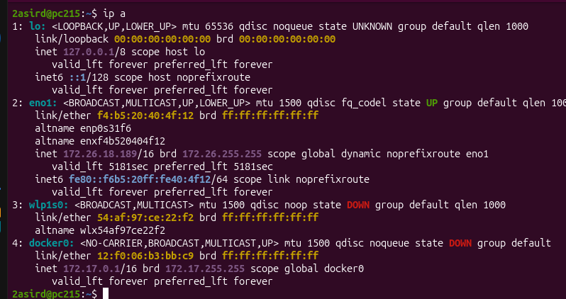
</div>

- **Comando utilizado:** `ip a`
- **Resultados obtenidos:**
  - **Interfaz de red activa:** `eno1` (estado `UP`, MTU 1500).
  - **Dirección IPv4:** `172.26.18.189/16` con dirección de broadcast `172.26.255.255`.
  - **Dirección física MAC:** `f4:b5:20:40:4f:12`.
  - **Dirección IPv6 de enlace local (*Link-Local*):** `fe80::f6b5:20ff:fe40:4f12/64`.
  - **Otras interfaces presentes:** `lo` (loopback `127.0.0.1/8`), `wlp1s0` (Wi-Fi en estado `DOWN`) y `docker0` (`172.17.0.1/16` en estado `DOWN`).

---

### 1.2 Puerta de enlace predeterminada
> **Pregunta:** Anota la puerta de enlace predeterminada.

<div align="center">
  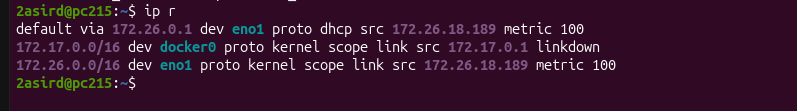
</div>

- **Comando utilizado:** `ip r` (o `ip route`)
- **Resultado obtenido:**
  - **Puerta de enlace (*Default Gateway*):** `172.26.0.1` a través de la interfaz `eno1`.
  - **Ruta por defecto:** `default via 172.26.0.1 dev eno1 proto dhcp src 172.26.18.189 metric 100`.

---

### 1.3 Dirección de red y prefijo o máscara
> **Pregunta:** Indica la dirección de red y su prefijo o máscara.

<div align="center">
  
</div>

- **Dirección de red:** `172.26.0.0`
- **Prefijo de red:** `/16` (notación CIDR).
- **Máscara de subred equivalente:** `255.255.0.0` (red de clase B privada con hasta 65.534 direcciones IP utilizables).
- **Ruta directa en la tabla del kernel:** `172.26.0.0/16 dev eno1 proto kernel scope link src 172.26.18.189 metric 100`.

---

## 2.- Analizar y renovar una entrada ARP

### 2.1 Comprobación de pertenencia a la subred
> **Pregunta:** El profesor proporcionará la IP de su ordenador: **`172.26.20.3`**. Comprueba que está en tu misma red local IPv4.

<div align="center">
  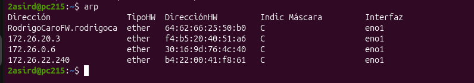
</div>

- **Comprobación de direccionamiento:**
  - La red local es `172.26.0.0/16`, cuyo rango de direcciones utilizables va desde `172.26.0.1` hasta `172.26.255.254`.
  - Como `172.26.20.3` se encuentra dentro de ese rango, **pertenece a la misma red local física e interactúa en capa 2 sin necesidad de enrutamiento**.
- **Entrada observada en la tabla:**
  ```text
  172.26.20.3    ether    f4:b5:20:40:51:a6    C    eno1
  ```

---

### 2.2 Comparativa de comandos ARP
> **Pregunta:** Ejecuta los siguientes comandos e indica qué hace cada uno.

#### 1. `arp -a`
<div align="center">
  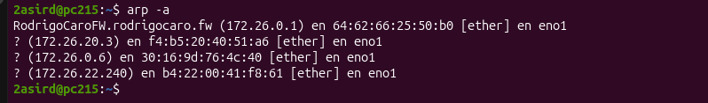
</div>

- **Función:** Muestra la tabla ARP actual intentando resolver los nombres de host mediante DNS reverso (*ej. `RodrigoCaroFW.rodrigocaro.fw (172.26.0.1)`*). Si un host no tiene resolución, muestra un signo de interrogación `?`.

#### 2. `arp -n`
<div align="center">
  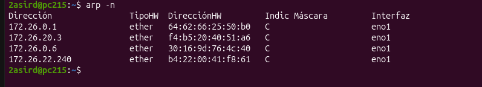
</div>

- **Función:** Muestra la tabla ARP en **formato numérico puro**. No pierde tiempo en consultas DNS, listando directamente las direcciones IP junto a su tipo de hardware (`ether`), dirección MAC (`DirecciónHW`) y la interfaz (`eno1`).

#### 3. `ip neigh`
<div align="center">
  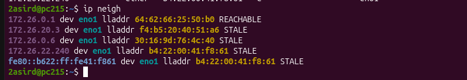
</div>

- **Función:** Es la herramienta moderna de Linux (*iproute2*) para inspeccionar la **tabla de vecinos** (*neighbour table*). Muestra la dirección IP, la interfaz, la dirección física (`lladdr`) y el **estado de validez de la entrada**:
  - `REACHABLE`: La entrada está confirmada, viva y operativa.
  - `STALE`: La entrada ha envejecido; el sistema asume que sigue ahí pero renovará la comprobación al próximo envío.

---

### 2.3 MAC del gateway y comportamiento de la tabla ARP
> **Pregunta:** ¿Qué MAC aparece asociada a la puerta de enlace? ¿Por qué la tabla ARP no muestra todos los equipos de la red?

<div align="center">
  
</div>

- **MAC de la puerta de enlace (`172.26.0.1`):** `64:62:66:25:50:b0`.
- **¿Por qué no muestra todos los equipos de la red?**
  - La tabla ARP **no realiza un descubrimiento pasivo global**. Solo almacena en memoria caché las correspondencias IP-MAC de aquellos equipos con los que nuestro ordenador ha mantenido comunicación directa recientemente (por ejemplo, para resolver tráfico, hacer ping o abrir una sesión). Si con un equipo de la red no se ha intercambiado ningún paquete, no existirá en la tabla.

---

### 2.4 Generar y consultar la entrada ARP
> **Pregunta:** Genera y consulta la entrada del profesor mediante `ping` e `ip neigh show`.

#### Paso 1: Enviar paquetes ICMP
<div align="center">
  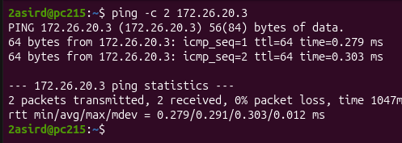
</div>

```bash
ping -c 2 172.26.20.3
```
- Se transmiten 2 paquetes y se reciben 2 (0% pérdida) con una latencia media (*RTT*) de **0.291 ms**.

#### Paso 2: Consultar la entrada en la tabla de vecinos
<div align="center">
  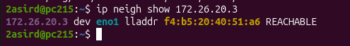
</div>

```bash
ip neigh show 172.26.20.3
```
- **Resultado:** `172.26.20.3 dev eno1 lladdr f4:b5:20:40:51:a6 REACHABLE` (asociación activa y verificada).

---

### 2.5 Eliminar la asociación ARP del equipo
> **Pregunta:** Elimina únicamente esa asociación en tu ordenador con `ip neigh del` y comprueba inmediatamente que ya no aparece.

<div align="center">
  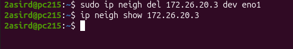
</div>

- **Comandos ejecutados:**
  ```bash
  sudo ip neigh del 172.26.20.3 dev eno1
  ip neigh show 172.26.20.3
  ```
- **Resultado:** El segundo comando no devuelve ninguna salida; la entrada ha sido purgada de la memoria caché del kernel.

---

### 2.6 Regeneración automática de la entrada
> **Pregunta:** Si no se genera automáticamente, vuelve a generarla con tráfico.

<div align="center">
  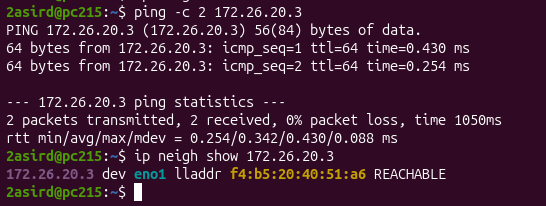
</div>

- **Comandos ejecutados:**
  ```bash
  ping -c 2 172.26.20.3
  ip neigh show 172.26.20.3
  ```
- **Resultado:** Al emitir los paquetes de `ping`, el stack de red de Linux emite un *ARP Request* por broadcast, el equipo del profesor responde con su MAC y la entrada vuelve a registrarse en estado `REACHABLE` (`f4:b5:20:40:51:a6`).

---

## 3.- Descubrir equipos con Nmap

### 3.1 Escaneo de hosts activos con `nmap -sn`
> **Pregunta:** Utilizando el comando `nmap`, con la opción `-sn`, escanea desde la `172.26.20.0` hasta la `172.26.20.255`.

<div align="center">
  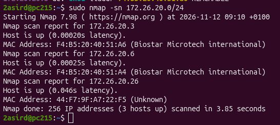
</div>

- **Comando:** `sudo nmap -sn 172.26.20.0/24`
- **Resultados del descubrimiento (256 IPs analizadas en 3.85 segundos):**
  - **`172.26.20.3`**: Host activo (`latency 0.00020s`), MAC `F4:B5:20:40:51:A6` (*Biostar Microtech international*).
  - **`172.26.20.6`**: Host activo (`latency 0.00025s`), MAC `F4:B5:20:40:51:A4` (*Biostar Microtech international*).
  - **`172.26.20.26`**: Host activo (`latency 0.046s`), MAC `44:F7:9F:A7:22:F5` (*Fabricante desconocido*).

---

### 3.2 Función de la opción `-sn`
> **Pregunta:** ¿Qué hace exactamente la opción `-sn`?

Indica a `nmap` que realice exclusivamente el **descubrimiento de hosts activos (*Ping Scan*)**, sin ejecutar ningún escaneo de puertos TCP o UDP en las máquinas detectadas. Es la forma más rápida y silenciosa de mapear qué dispositivos están encendidos en una subred.

---

## 4.- Examinar puertos y servicios

### 4.1 Escaneo de puertos y detección de versiones
> **Pregunta:** Escanea exclusivamente la máquina objetivo indicada por el profesor (`172.26.20.3`) mediante `nmap` y `nmap -sV`.

<div align="center">
  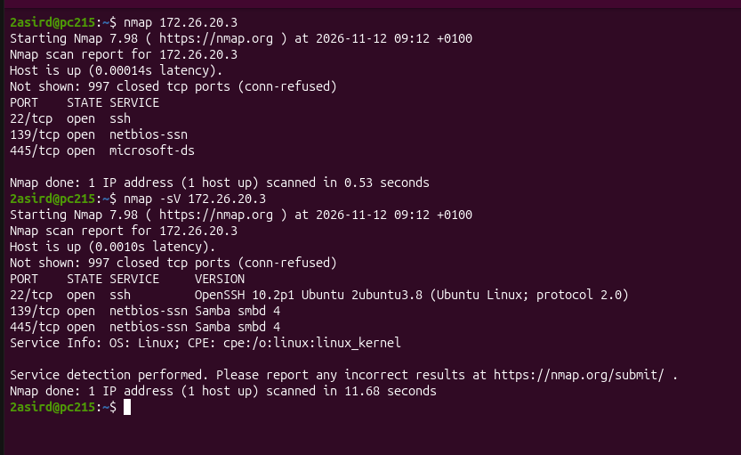
</div>

- **Comandos ejecutados:**
  1. `nmap 172.26.20.3`: Mapea los puertos más frecuentes (encuentra 22, 139 y 445 abiertos en 0.53 segundos).
  2. `nmap -sV 172.26.20.3`: Identifica el servicio y la versión detallada de cada puerto.
- **Desglose de servicios encontrados:**
  - **Puerto `22/tcp` (Abierto):** Servicio `ssh` corriendo la versión `OpenSSH 10.2p1 Ubuntu 2ubuntu3.8 (Ubuntu Linux; protocol 2.0)`.
  - **Puerto `139/tcp` (Abierto):** Servicio `netbios-ssn` corriendo `Samba smbd 4`.
  - **Puerto `445/tcp` (Abierto):** Servicio `microsoft-ds` corriendo `Samba smbd 4`.
  - **Información del Sistema:** `Service Info: OS: Linux; CPE: cpe:/o:linux:linux_kernel`.

---

### 4.2 Función de la opción `-sV`
> **Pregunta:** ¿Qué hace la opción `-sV`?

La opción `-sV` (*Service Version Detection*) interroga a los puertos abiertos enviando una serie de sondas (*probes*) diseñadas para cada protocolo, con el objetivo de **identificar con precisión la aplicación exacta y el número de versión** del demonio que está respondiendo, así como datos adicionales del sistema operativo subyacente.

---

[⬅️ Volver al Índice Principal](README.md)
