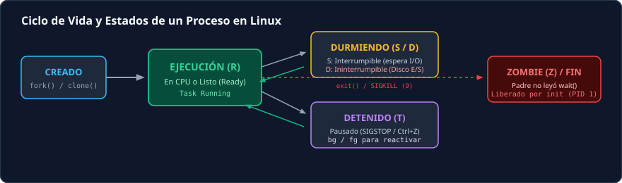
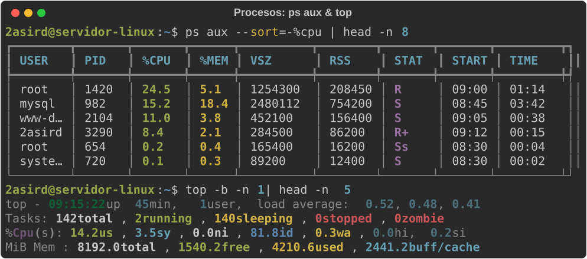
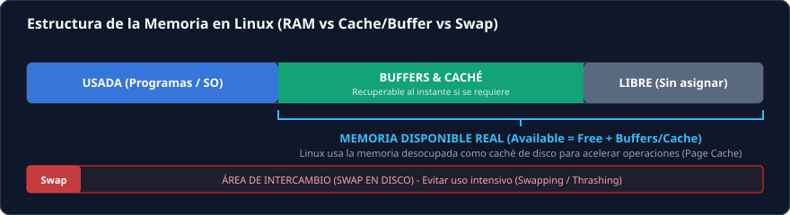
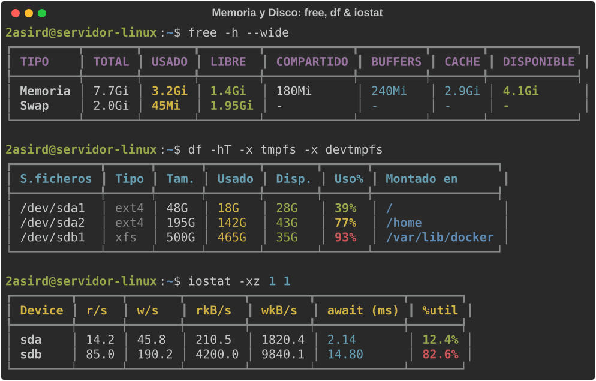
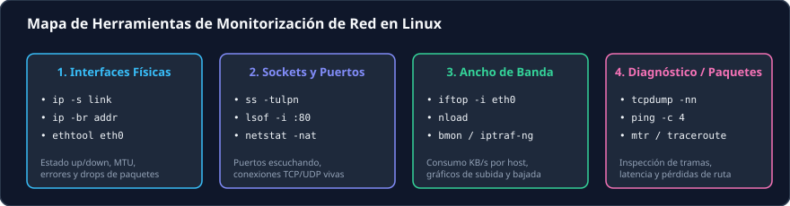
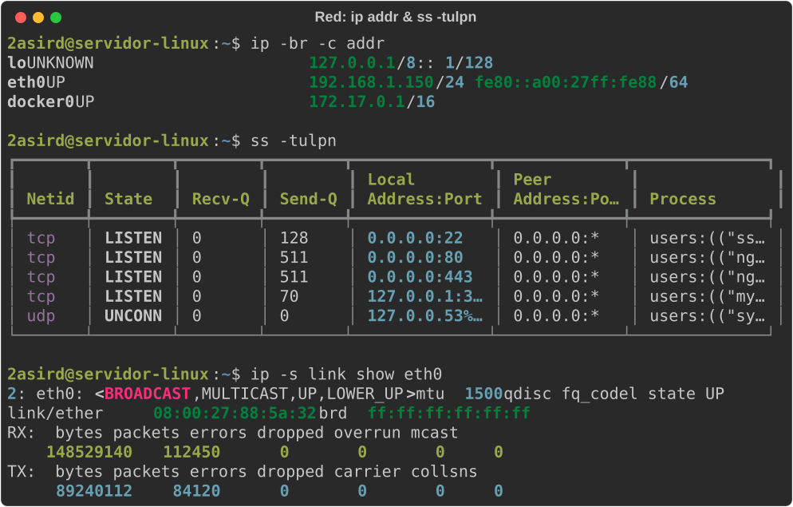
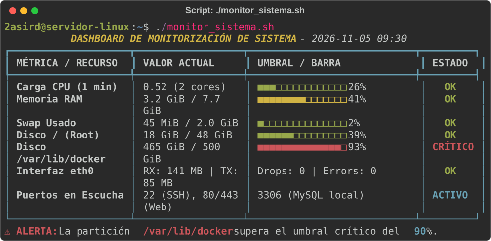

<div align="center">


<p align="center">
  
  
  
  
  
</p>

<p align="center">
  <b>Manual integral de diagnóstico, métricas de rendimiento y administración de recursos en servidores Linux.</b><br>
  Orientado a Administración de Sistemas Informáticos en Red (ASIR) y entornos DevOps.
</p>

</div>

---

## 📑 Tabla de Contenidos

1. [Procesos y Rendimiento de CPU](#1-procesos-y-rendimiento-de-cpu)
   - [Ciclo de vida y estados](#11-ciclo-de-vida-y-estados-de-un-proceso)
   - [Comandos esenciales (`ps`, `top`, `htop`)](#12-comandos-esenciales-de-inspección)
   - [Gestión de señales (`kill`, `pkill`)](#13-control-y-señales-del-sistema)
2. [Memoria, Espacio y Rendimiento del Disco](#2-memoria-espacio-y-rendimiento-del-disco)
   - [Arquitectura de memoria (RAM vs Caché vs Swap)](#21-gestión-de-memoria-ram-y-swap)
   - [Inspección de memoria (`free`, `vmstat`)](#22-herramientas-de-memoria)
   - [Almacenamiento y Filesystems (`df`, `du`, `lsblk`)](#23-espacio-en-disco-y-sistemas-de-archivos)
   - [Rendimiento de E/S y cuellos de botella (`iostat`, `iotop`)](#24-rendimiento-de-disco-io-wait)
3. [Tráfico y Diagnóstico de Red](#3-tráfico-y-diagnóstico-de-red)
   - [Interfaces físicas y errores (`ip link`, `ethtool`)](#31-interfaces-físicas-y-enlace)
   - [Sockets y puertos en escucha (`ss`, `lsof`)](#32-sockets-y-puertos-en-escucha)
   - [Ancho de banda en tiempo real (`iftop`, `nload`)](#33-consumo-de-ancho-de-banda)
   - [Captura y diagnóstico de paquetes (`tcpdump`, `ping`, `mtr`)](#34-captura-y-diagnóstico-de-paquetes)
4. [Script Automatizado de Monitorización](#4-script-automatizado-de-monitorización)
5. [Guía Rápida de Diagnóstico (Cheat Sheet)](#5-guía-rápida-de-diagnóstico-cheat-sheet)

---

## 1. Procesos y Rendimiento de CPU

> [!TIP]
> 📸 Consulta el informe práctico paso a paso analizando cada captura real en el documento [**`1.md`**](1.md).

Un proceso en Linux es cualquier instancia de un programa en ejecución con su propio espacio de memoria virtual, identificador único (**PID**), descriptor de archivos y contexto de ejecución gestionado por el planificador del kernel (*scheduler*).

### 1.1 Ciclo de vida y estados de un proceso

Los procesos alternan entre distintos estados según su interacción con la CPU y los dispositivos de entrada/salida:

<div align="center">
  
</div>

| Estado | Código | Descripción Técnica |
| :--- | :---: | :--- |
| **Running** | `R` | En ejecución en una CPU o en cola esperando su turno de planificación. |
| **Interruptible Sleep** | `S` | Esperando un evento o señal (espera en un socket, temporizador, etc.). |
| **Uninterruptible Sleep** | `D` | Espera profunda de hardware (generalmente lectura/escritura en disco o NFS). **No responde a `kill -9`**. |
| **Stopped** | `T` | Pausado manualmente por señal (`SIGSTOP` o `Ctrl + Z`). |
| **Zombie / Defunct** | `Z` | Ha finalizado su ejecución, pero el proceso padre aún no ha leído su código de salida con `wait()`. |

---

### 1.2 Comandos esenciales de inspección

<div align="center">
  
</div>

#### `ps` (Process Status - Instantánea estática)

```bash
# Top 10 procesos que más CPU consumen
ps aux --sort=-%cpu | head -n 11

# Top 10 procesos que más memoria RAM consumen
ps aux --sort=-%mem | head -n 11

# Visualización personalizada con formato específico
ps -eo pid,ppid,user,%cpu,%mem,stat,comm --sort=-%cpu | head -n 15

# Ver el árbol de jerarquía padre-hijo
ps -ejH
# o bien
pstree -p
```

#### `top` y `htop` (Monitorización interactiva dinámica)

- **`top`**: Nativo en todas las distribuciones.
  - Pulsa <kbd>M</kbd> para ordenar por consumo de memoria.
  - Pulsa <kbd>P</kbd> para ordenar por consumo de CPU.
  - Pulsa <kbd>k</kbd> para enviar una señal de terminación a un PID.
  - Pulsa <kbd>c</kbd> para alternar entre el nombre simple y la ruta completa del comando.
- **`htop`**: Interfaz visual con barras de progreso a color y soporte de ratón (`sudo apt install htop`).

---

### 1.3 Control y señales del sistema

Para detener, recargar o forzar el cierre de procesos se envían señales al kernel:

```bash
# Finalización limpia (solicita al programa cerrar buffers y guardar datos)
kill -15 <PID>      # o kill -SIGTERM <PID>

# Forzar terminación inmediata (el proceso no puede interceptar esta señal)
kill -9 <PID>       # o kill -SIGKILL <PID>

# Recargar configuración sin reiniciar el servicio
kill -1 <PID>       # o kill -SIGHUP <PID>

# Finalizar por nombre de proceso
pkill -u www-data nginx
killall -9 php-fpm
```

---

## 2. Memoria, Espacio y Rendimiento del Disco

Una monitorización eficaz del almacenamiento exige distinguir entre **capacidad física (GB)** y **velocidad de respuesta (latencia de E/S / I/O Wait)**.

### 2.1 Gestión de memoria RAM y Swap

Linux optimiza la memoria no utilizada empleándola como **Caché de Páginas (Page Cache)** y **Buffers** para acelerar el acceso a los discos. Por tanto, que la memoria libre sea baja no significa que el sistema esté saturado:

<div align="center">
  
</div>

- **Memoria Real Disponible** = $\text{Libre} + \text{Buffers} + \text{Caché recuperable}$
- **Swap (Espacio de intercambio)**: Espacio en disco reservado cuando la RAM escasea. Si hay actividad continua de lectura/escritura en Swap (*swapping*), el rendimiento se degrada críticamente (*thrashing*).

---

### 2.2 Herramientas de memoria

<div align="center">
  
</div>

```bash
# Visualizar memoria en formato legible (Megabytes / Gigabytes)
free -h --wide

# Monitorizar memoria y paginación en tiempo real cada 2 segundos (5 iteraciones)
vmstat -w 2 5

# Detalle completo expuesto directamente por el kernel
cat /proc/meminfo | grep -E "MemTotal|MemFree|MemAvailable|Buffers|Cached|SwapTotal|SwapFree"
```

> [!NOTE]
> En la salida de `vmstat`, observa las columnas **`si`** (*swap-in*) y **`so`** (*swap-out*). Si tienen valores superiores a cero de forma persistente, el servidor tiene déficit de memoria física.

---

### 2.3 Espacio en disco y sistemas de archivos

```bash
# Mostrar uso de particiones excluyendo sistemas de archivos virtuales (tmpfs)
df -hT -x tmpfs -x devtmpfs -x squashfs

# Identificar qué carpetas ocupan más espacio en un directorio
du -h --max-depth=1 /var/log | sort -hr | head -n 10

# Estructura jerárquica de bloques y discos conectados
lsblk -f

# Explorador interactivo por terminal (muy recomendado)
sudo apt install ncdu
ncdu /var
```

---

### 2.4 Rendimiento de disco (I/O Wait)

Cuando el porcentaje `%wa` en `top` es alto, la CPU está ociosa esperando respuestas de lectura/escritura del disco.

```bash
# Estadísticas detalladas de latencia y saturación por dispositivo (paquete sysstat)
iostat -xz 1 5

# Localizar exactamente qué procesos están generando lecturas/escrituras en disco
sudo iotop -o
```

**Métricas críticas en `iostat`:**
- **`await`**: Tiempo medio en milisegundos que tarda una petición de E/S. Un valor $> 20\text{ ms}$ en discos mecánicos o $> 5\text{ ms}$ en SSDs indica saturación.
- **`%util`**: Porcentaje de tiempo que el disco estuvo ocupado. Valores cercanos al **100%** indican cuello de botella absoluto en el dispositivo.

---

## 3. Tráfico y Diagnóstico de Red

La monitorización de red abarca desde la salud física de las interfaces de red hasta el análisis en vivo del flujo de paquetes y sockets abiertos.

<div align="center">
  
</div>

---

### 3.1 Interfaces físicas y enlace

```bash
# Listado compacto de interfaces, estado y direcciones IP
ip -br -c addr

# Estadísticas de transmisión y recepción (RX/TX), errores y paquetes descartados (drops)
ip -s link show eth0

# Consultar velocidad negociada (Speed), Duplex y estado del enlace físico
sudo ethtool eth0 | grep -E "Speed|Duplex|Link detected"
```

<div align="center">
  
</div>

---

### 3.2 Sockets y puertos en escucha

El comando `ss` (*Socket Statistics*) es el sustituto oficial, de alto rendimiento y moderno para el antiguo `netstat`:

```bash
# Listar todos los puertos TCP y UDP en estado de escucha (LISTEN) con su PID y binario
sudo ss -tulpn

# Ver conexiones TCP activas y establecidas
ss -tan state established

# Buscar qué proceso exacto tiene ocupado un puerto específico (p. ej. puerto 80)
sudo lsof -i :80
```

---

### 3.3 Consumo de ancho de banda

```bash
# Monitor interactivo de tráfico en tiempo real por host / IP (paquete iftop)
sudo iftop -i eth0 -n -P

# Gráfica en tiempo real de subida (Outgoing) y bajada (Incoming)
nload eth0

# Vista global multipanel para todas las interfaces de red
bmon
```

---

### 3.4 Captura y diagnóstico de paquetes

```bash
# Diagnóstico de conectividad básica (4 paquetes ICMP)
ping -c 4 8.8.8.8

# Traza de ruta combinada con estadísticas de pérdida de paquetes en tiempo real
mtr -rw 1.1.1.1

# Capturar tráfico HTTP en el puerto 80 sin resolver DNS ni nombres de puertos
sudo tcpdump -nn -i any port 80 -c 10

# Guardar captura en archivo .pcap para análisis en Wireshark
sudo tcpdump -w captura_red.pcap -i eth0 port 443
```

---

## 4. Script Automatizado de Monitorización

Este repositorio incluye una herramienta lista para usar en [`scripts/monitor_sistema.sh`](scripts/monitor_sistema.sh). Permite obtener un diagnóstico visual instantáneo de CPU, Memoria, Particiones y Red con alertas de umbral de color:

<div align="center">
  
</div>

### Ejecución rápida:

```bash
# 1. Clonar el repositorio
git clone https://github.com/eljoviz/monitorizacion.git
cd monitorizacion

# 2. Asignar permisos de ejecución
chmod +x scripts/monitor_sistema.sh

# 3. Ejecutar el dashboard
./scripts/monitor_sistema.sh
```

---

## 5. Guía Rápida de Diagnóstico (Cheat Sheet)

| Síntoma / Problema | Comando Recomendado | Parámetros Clave | Qué buscar |
| :--- | :--- | :--- | :--- |
| **El servidor responde lento** | `uptime` / `top` | `load average` | Carga superior al número de cores disponibles (`nproc`). |
| **Proceso consumiendo 100% CPU** | `ps aux --sort=-%cpu` | Columna `%CPU` | Identificar PID problemático y evaluar `kill -15` o `kill -9`. |
| **La aplicación se cierra sola (OOM)** | `dmesg -T` | `grep -i oom` | Avisos de *Out of Memory Killer* liquidando procesos por falta de RAM. |
| **Memoria agotada** | `free -h` | `available` / `swap` | Si `available` se acerca a 0 y `swap used` crece continuamente. |
| **Disco lleno (No space left)** | `df -hT` | Columna `Use%` | Particiones al 100% o inodos agotados (`df -i`). |
| **Archivos gigantes desconocidos** | `du -h --max-depth=1` | `/var/log` o `/var` | Localizar logs descontrolados o ficheros temporales. |
| **I/O Wait muy alto (%wa en top)** | `iostat -xz 1` | Columna `%util` | Dispositivo de almacenamiento saturado al 100%. |
| **Un puerto no responde** | `ss -tulpn` | `Local Address:Port` | Verificar si el servicio realmente está en `LISTEN` en `0.0.0.0` o solo en `127.0.0.1`. |
| **Tráfico excesivo de red** | `iftop -i <interfaz>` | Columnas de tasa | Identificar la IP remota que satura el canal. |

---

<div align="center">
  <sub>Desarrollado para el módulo de Administración de Sistemas y DevOps • <b>Jose Vizuete</b></sub>
</div>
