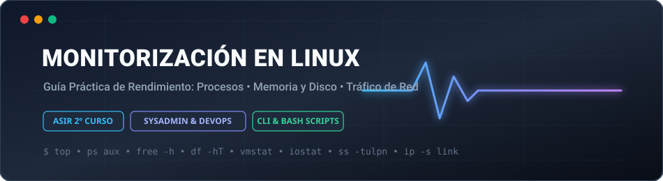

# Monitorización de Sistemas Linux

---

## 📑 Índice

1. [**Procesos y Rendimiento de CPU**](1.md)
   - Estados de los procesos, filtrado con `ps`, monitorización dinámica con `top` y `htop`, control de señales y eliminación de procesos en bucle.

2. [**Memoria, Espacio y Rendimiento del Disco**](2.md)
   - Gestión de RAM física, Buffers, Page Cache y Swap con `free` y `free -s`. Almacenamiento y rendimiento de disco.

3. [**Tráfico y Diagnóstico de Red**](3.md)
   - Interfaces físicas, sockets (`ss`), titularidad IP (`whois`), auditoría con `nmap`, resolución `arp`, ancho de banda (`iptraf`, `tcptrack`, `bmon`) y captura de paquetes (`tcpdump`).

4. [**Tarea Práctica: Análisis de Red Local**](4.md)
   - Práctica de laboratorio evaluable: Configuración de red (`ip a`, `ip r`), gestión de caché de vecinos ARP (`arp`, `ip neigh`), descubrimiento de red con Nmap (`-sn`) y detección de servicios y versiones (`-sV`).

---

  Módulo de Administración de Sistemas y DevOps • <b>Jose Vizuete</b>

